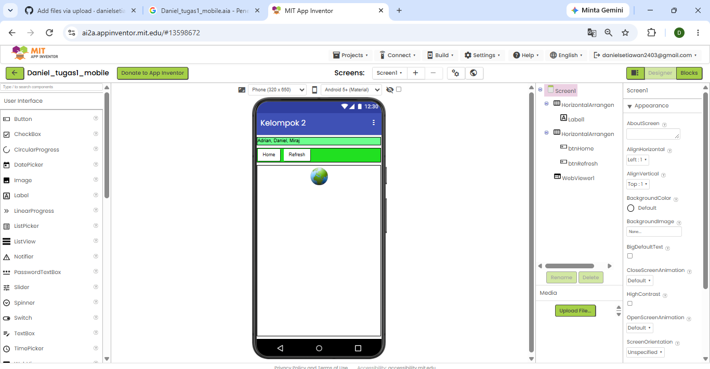
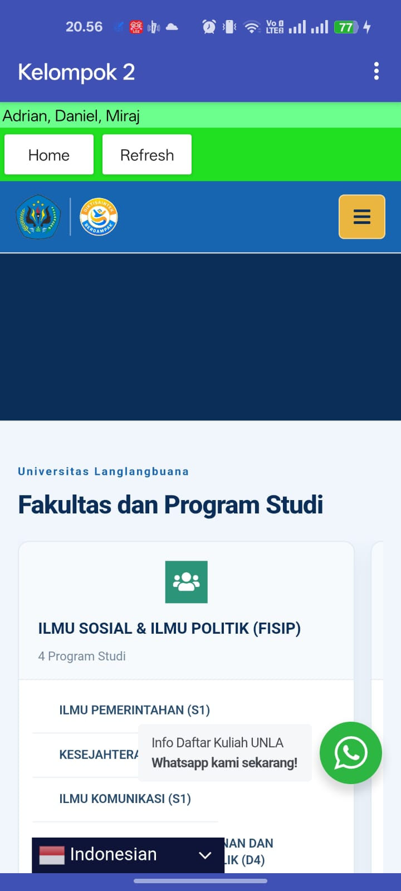
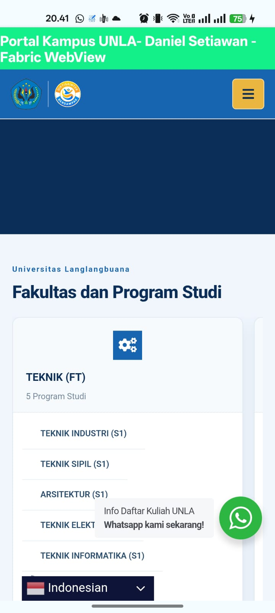

# Tugas Mobile: Implementasi WebView

Repositori ini berisi dua tugas pemrograman mobile yang sama-sama menampilkan halaman web di dalam aplikasi menggunakan komponen WebView, dengan teknologi yang berbeda.

| Tugas | Teknologi | Lokasi |
|-------|-----------|--------|
| Tugas 2 | MIT App Inventor (komponen WebViewer) | `tugas-2-app-inventor/` |
| Tugas 3 | React Native CLI, Fabric (New Architecture), `react-native-webview` | root repositori |

---

## Tugas 2: WebView dengan MIT App Inventor

Prototipe aplikasi Android yang menampilkan halaman web menggunakan komponen **WebViewer** di MIT App Inventor.

### Tampilan

**Desain di MIT App Inventor (Designer)**



**Tampilan di HP**



### Cara membuka proyek

1. Buka [ai2.appinventor.mit.edu](https://ai2.appinventor.mit.edu) dan login dengan akun Google.
2. Pilih menu **Projects > Import project (.aia) from my computer**.
3. Pilih file `tugas-2-app-inventor/Daniel_tugas1_mobile.aia`.
4. Jalankan lewat **Connect > AI Companion** (scan QR dengan aplikasi MIT AI2 Companion di HP), atau **Build > Android App (.apk)**.

---

## Tugas 3: WebView dengan React Native (Fabric)

Aplikasi React Native yang mengaktifkan **Fabric / New Architecture** dan menampilkan halaman web portal kampus UNLA memakai paket `react-native-webview`. Aplikasi memiliki header berjudul "Portal Kampus UNLA-Daniel - Fabric WebView" dan area WebView di bawahnya.

### Tampilan



### Teknologi

- React Native 0.87 (React Native CLI, bukan Expo)
- TypeScript
- `react-native-webview`
- New Architecture (Fabric): `newArchEnabled=true` pada `android/gradle.properties`

### Prasyarat

- Node.js dan npm
- JDK 17
- Android SDK (command-line tools atau Android Studio)
- HP Android dengan USB debugging aktif, atau emulator

### Cara menjalankan

```bash
git clone https://github.com/danielsetiawan2403/TugasWebViewFabric.git
cd TugasWebViewFabric
npm install
npx react-native run-android
```

Jika layar HP menampilkan error merah "Unable to load script", jalankan:

```bash
adb reverse tcp:8081 tcp:8081
```

lalu reload aplikasi.

### Struktur utama

```
App.tsx                  # Kode utama aplikasi WebView (Tugas 3)
android/                 # Proyek native Android
tugas-2-app-inventor/    # Berkas proyek MIT App Inventor (Tugas 2)
screenshots/             # Tangkapan layar tampilan aplikasi
```

## Pembuat

Daniel Setiawan